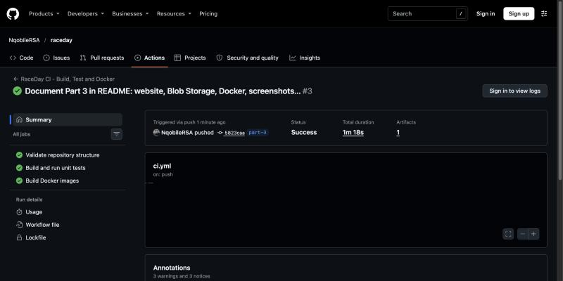
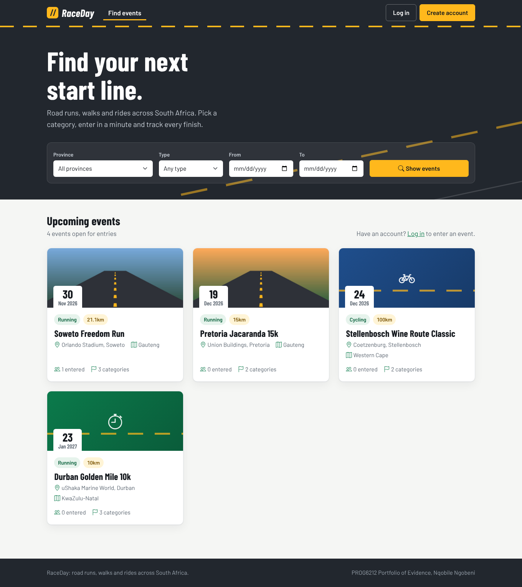
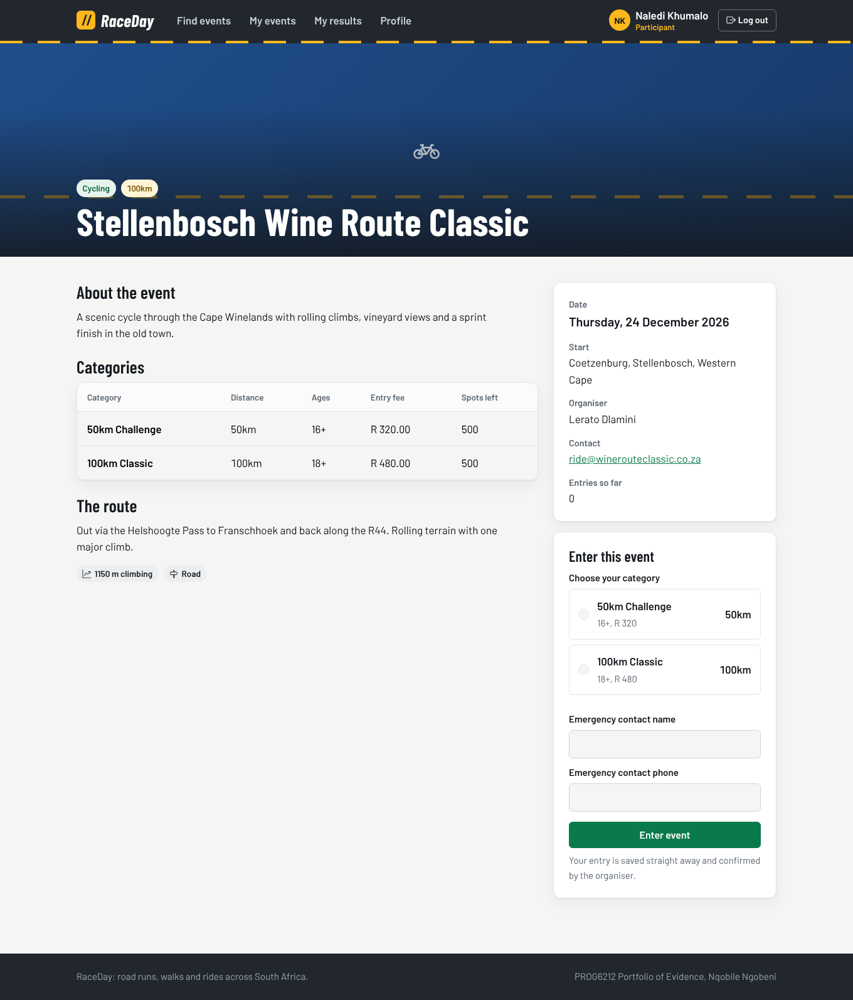
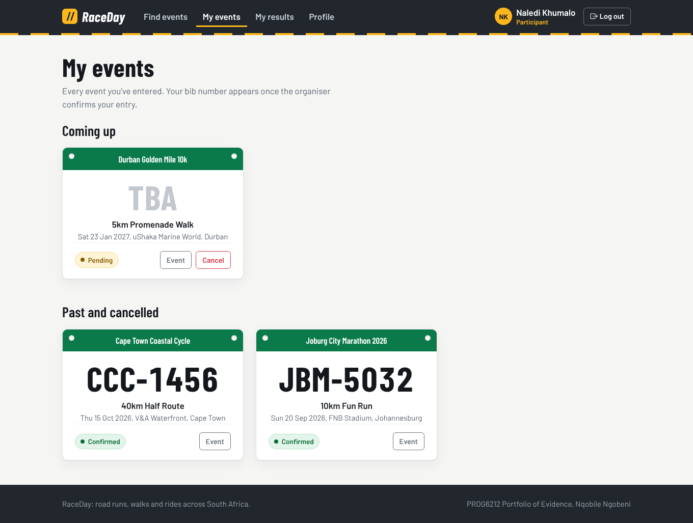
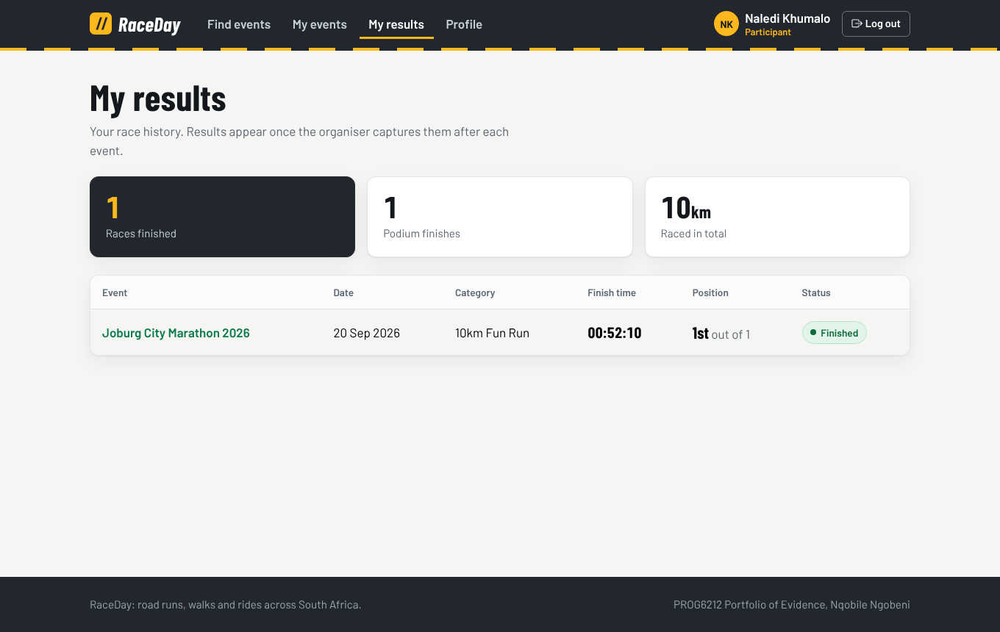
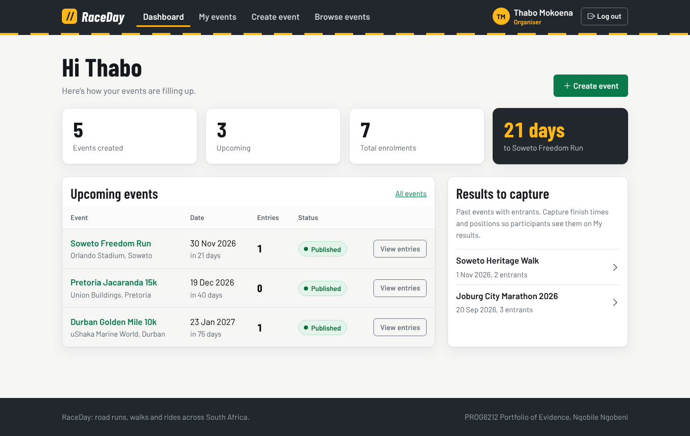
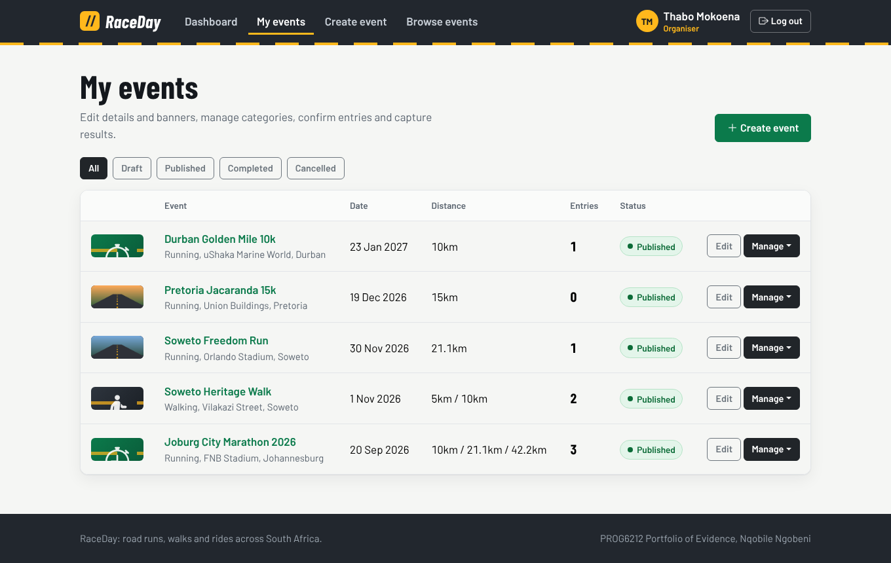
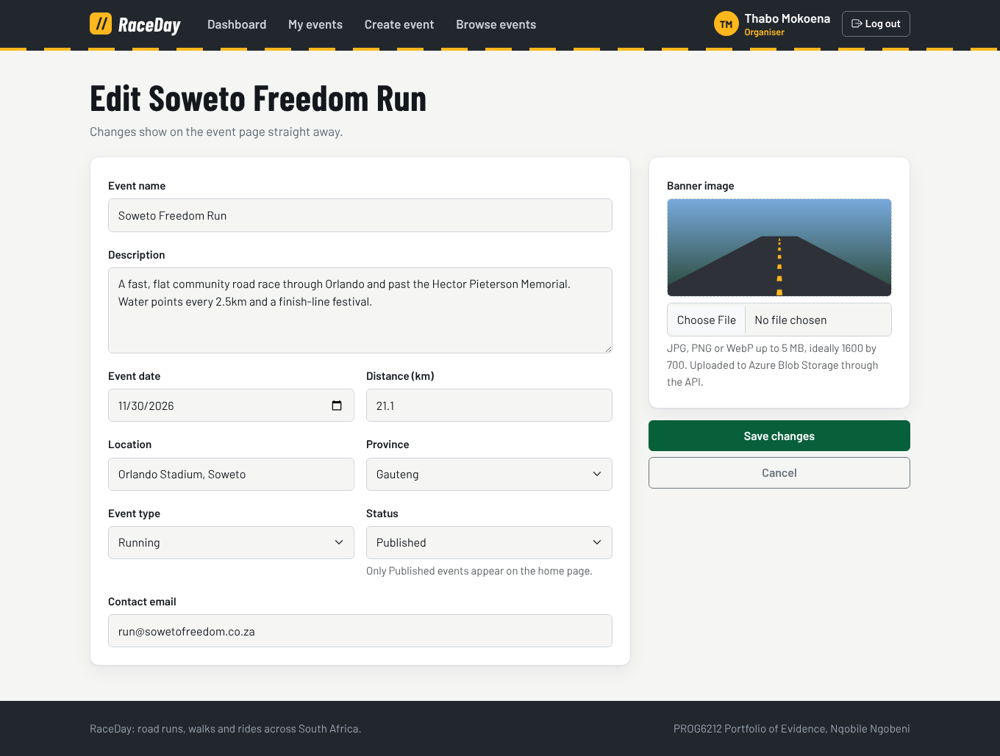
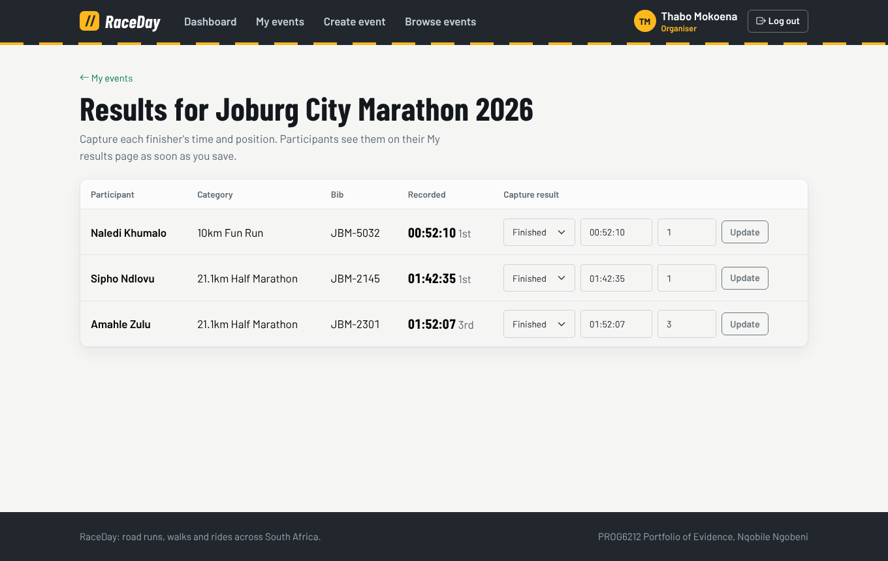

# RaceDay

**RaceDay** is a full-stack, web-based event management system for the South African road running, walking and cycling community. Organisers create and manage events, categories and results. Participants browse events, enter by choosing a category, track their enrolments and see their personal race history, and can check live race-day weather for the route.

The system has two applications: an ASP.NET Core **Web API** that owns all data, rules and storage, and an ASP.NET Core **MVC website** that people use in the browser. The website talks only to the API.

The project is built in three parts for the PROG6212 Portfolio of Evidence:

| Part       | Scope                                                                                          | Status              |
| ---------- | ---------------------------------------------------------------------------------------------- | ------------------- |
| Part 1     | ERD, API endpoint plan, SQL script, CI structure validation                                    | Complete (`/docs`)  |
| Part 2     | ASP.NET Core Web API, EF Core Code-First, session auth, Swagger, unit tests, CI build and test | Complete            |
| **Part 3** | **ASP.NET Core MVC front end, Azure Blob Storage, Docker, CI for every project**               | **This submission** |

---

## Part 3 Submission

| Item                                  | Link                                                                                                                                                                     |
| ------------------------------------- | ------------------------------------------------------------------------------------------------------------------------------------------------------------------------ |
| Video presentation (unlisted YouTube) | **[Watch the Part 3 walkthrough](https://youtu.be/FJZsWeJexl8)**                                                                                                         |
| Branch                                | `part-3`                                                                                                                                                                 |
| CI/CD workflow                        | [`.github/workflows/ci.yml`](./.github/workflows/ci.yml)                                                                                                                 |
| Docker setup                          | [`docker-compose.yml`](./docker-compose.yml), [`src/RaceDay.Web/Dockerfile`](./src/RaceDay.Web/Dockerfile), [`src/RaceDay.Api/Dockerfile`](./src/RaceDay.Api/Dockerfile) |

### Run the whole system with one command

With Docker Desktop running, from the repository root:

```bash
docker compose up --build
```

| Open                   | URL                           |
| ---------------------- | ----------------------------- |
| RaceDay website (MVC)  | **http://localhost:8080**     |
| API and Swagger        | http://localhost:5080/swagger |
| Blob storage (Azurite) | http://localhost:10000        |

This starts four containers: SQL Server, Azurite (the official Azure Storage emulator), the API and the MVC website. The API waits for SQL Server, applies the EF Core migrations and seeds demo data, and the website waits until the API reports healthy. The first build takes a few minutes; later runs start in under a minute. Stop everything with `Ctrl+C`, or `docker compose down` (add `-v` to wipe the database and uploaded images).

Log in with any seeded account below (password `Password123!`), or create a new one from **Create account**.

### CI/CD green build (Part 3)



<!-- After the first green run on part-3: open the Actions tab, screenshot the passing run (all three jobs), save it as docs/ci-part3-screenshot.png and commit it. -->

---

## Part 2 Submission

| Item                                  | Link                                                             |
| ------------------------------------- | ---------------------------------------------------------------- |
| Video presentation (unlisted YouTube) | **[Watch the Part 2 walkthrough](https://youtu.be/iOWRQRSEOMw)** |
| CI/CD workflow                        | [`.github/workflows/ci.yml`](./.github/workflows/ci.yml)         |
| Endpoint plan (specification)         | [`docs/API_ENDPOINT_PLAN.md`](./docs/API_ENDPOINT_PLAN.md)       |

### CI/CD green build


<!-- After the first green run: open the Actions tab, screenshot the passing run, save it as docs/ci-part2-screenshot.png and commit it. -->

---

## User Roles

Role-based access is enforced at the API level on every protected endpoint.

| Role            | Can do                                                                                                                                                                                                                                            |
| --------------- | ------------------------------------------------------------------------------------------------------------------------------------------------------------------------------------------------------------------------------------------------- |
| **Organiser**   | Create, edit and delete their own events; add, edit and delete categories; post route information and announcements; view all enrolments for their events and confirm them with a bib number; capture finish times and positions after the event. |
| **Participant** | Create an account; browse and filter events; enter an event by selecting a category; view and cancel their own enrolments; view their personal results (e.g. 47th out of 312 finishers); view and update their profile.                           |

An Organiser cannot use Participant endpoints and a Participant cannot use Organiser endpoints (the API returns `403 Forbidden`). An Organiser can also only change events they created.

---

## Tech Stack

| Layer             | Technology                                                                                                    |
| ----------------- | ------------------------------------------------------------------------------------------------------------- |
| Website           | ASP.NET Core 8 MVC with Razor views, Bootstrap 5.3, Bootstrap Icons, Barlow typeface                          |
| API               | ASP.NET Core 8 Web API (C#)                                                                                   |
| Data access       | Entity Framework Core 8, Code-First with migrations                                                           |
| Database          | SQL Server                                                                                                    |
| Authentication    | Server-side sessions (ASP.NET Core Session), PBKDF2 password hashing (ASP.NET Core Identity `PasswordHasher`) |
| API documentation | Swagger / Swashbuckle with XML comments                                                                       |
| Testing           | xUnit with the EF Core InMemory provider                                                                      |
| Image storage     | Azure Blob Storage (`Azure.Storage.Blobs`), Azurite emulator for local and Docker runs                        |
| Containers        | Docker multi-stage images, Docker Compose                                                                     |
| CI/CD             | GitHub Actions (structure validation, build, test, Docker image build and smoke test)                         |
| External API      | Open-Meteo (live weather, no API key required)                                                                |

---

## The MVC Website (Part 3)

`src/RaceDay.Web` is the front end. It has **no database connection, no EF Core and no Azure SDK**: every page gets and saves its data by calling the RaceDay API over HTTP (CI fails the build if a database or Azure package is ever added to it).

### How it talks to the API

- `Infrastructure/ApiClient.cs` is a typed `HttpClient` that sends and receives the API's snake_case JSON and turns API errors (`400` validation messages, `401`, `403`, `404`, `409`, `503`) into friendly messages shown on the page.
- **Sessions:** on login or register the website calls `POST /api/auth/login` or `/register`, keeps the API's session cookie inside its own server-side session, and stores the user's **ID, name and role** there too (`Infrastructure/SessionUser.cs`). Every later API call forwards that cookie, so the API still enforces roles on every request.
- **Access control:** `[RequireRole]` (`Infrastructure/RequireRoleAttribute.cs`) sends visitors who are not logged in to the login page (and back afterwards), and shows an access-denied page if the wrong role opens a page. If the API session expires, the website clears its session and asks the user to log in again.
- **Logout** calls `POST /api/auth/logout` and clears the website session.

### Pages

| Role            | Page                   | What it does                                                                                                                                 |
| --------------- | ---------------------- | -------------------------------------------------------------------------------------------------------------------------------------------- |
| Anyone          | Find events (home)     | Upcoming published events as cards with banner, date, distance and type; filter by province, type and date range                             |
| Anyone          | Event detail           | Description, categories (ages, fee, spots left), route, organiser contact, race-day weather when a route is set                              |
| Anyone          | Log in, Create account | Role picker on sign-up (Participant or Organiser); validation messages from the API shown on the form                                        |
| **Participant** | Enter event            | Choose a category on the event page and enter; the entry is saved straight away as **Pending**                                               |
| **Participant** | My events              | Every entry as a race bib, colour-coded by status (green Confirmed, amber Pending, grey Cancelled), bib number once confirmed, cancel button |
| **Participant** | My results             | Event, date, category, finish time and position, e.g. **47th out of 312**, plus totals                                                       |
| **Participant** | Profile                | Edit personal details and upload a profile picture                                                                                           |
| **Organiser**   | Dashboard              | Events created, upcoming events, total enrolments, days to the next event, entries per upcoming event, events awaiting results               |
| **Organiser**   | My events              | All their events with status filter; edit, manage categories, enrolments and results, delete                                                 |
| **Organiser**   | Create / Edit event    | Name, description, date, distance, location, province, type, status, contact email and banner image upload with preview                      |
| **Organiser**   | Categories             | Add, edit and delete age and distance categories (age limits, fee, capacity, gender)                                                         |
| **Organiser**   | Enrolments             | Every entry for the event, filter by category and status, confirm and assign bib numbers                                                     |
| **Organiser**   | Results                | Capture finish time, position or DNF/DNS/DQ for each entrant; only opens once the event date has passed                                      |

### Screenshots

| Find events (home)                                                                      | Event detail and entry                                                                  |
| --------------------------------------------------------------------------------------- | --------------------------------------------------------------------------------------- |
|                   |    |
| **My events (Participant)**                                                             | **My results (Participant)**                                                            |
|  |  |
| **Organiser dashboard**                                                                 | **Organiser events**                                                                    |
|                       |        |
| **Edit event with banner upload**                                                       | **Results capture**                                                                     |
|             |                         |

### Design

A sporting identity built around the road itself: an asphalt-grey header with a dashed gold lane marking, veld green for actions and confirmed states, race gold for highlights and pending states, condensed Barlow headings like race signage, and participant entries shown as race bibs. Status colours are consistent everywhere (`Views/Shared/_Status.cshtml`). The layout is responsive down to phone width, and pages degrade gracefully: if the API or weather service is down, the user sees a clear message instead of an error page, and unknown URLs get a custom 404.

---

## Azure Blob Storage (Part 3)

Event banners and profile pictures are stored in Azure Blob Storage **by the API only**. The website posts the uploaded file to the API, the API validates it and stores it, then saves the image URL on the event or user record. The website just displays the URL it gets back.

| Piece               | Where                                                                                                                                                   |
| ------------------- | ------------------------------------------------------------------------------------------------------------------------------------------------------- |
| Upload endpoints    | `POST /api/events/{id}/banner` (Organiser, owner only), `POST /api/users/me/profile-picture` (any logged-in user) in `Controllers/UploadsController.cs` |
| Storage service     | `Services/ImageStorage.cs`: `IImageStorage` and `AzureBlobImageStorage`                                                                                 |
| Containers          | `event-banners`, `profile-pictures` (created on first upload, private)                                                                                  |
| Validation          | JPG, PNG or WebP only, up to 5 MB, checked by the file's signature bytes, not just its name                                                             |
| URLs                | Containers stay private; each blob gets a read-only SAS link, so images display without making the account public                                       |
| Replacing an image  | The old blob is deleted after the new one is saved                                                                                                      |
| Storage unavailable | The API returns `503` with a clear message; the website shows it                                                                                        |

**Configuration** (`AzureStorage` section in `src/RaceDay.Api/appsettings.json`):

| Setting              | Default                      | Purpose                                                                                                                    |
| -------------------- | ---------------------------- | -------------------------------------------------------------------------------------------------------------------------- |
| `ConnectionString`   | `UseDevelopmentStorage=true` | Azurite locally. Set it to your storage account's connection string to use real Azure.                                     |
| `PublicBlobEndpoint` | empty                        | Only for Docker + Azurite: rewrites `http://azurite:10000` links to `http://localhost:10000` so the browser can load them. |
| `SasLifetimeDays`    | `1825`                       | How long image links stay valid.                                                                                           |

**Using a real Azure Storage account:** in the Azure portal create a Storage account (Standard, LRS is enough), open **Security + networking > Access keys** and copy the connection string. Then either copy `.env.example` to `.env` and paste it as `AZURE_STORAGE_CONNECTION_STRING` (Docker), or run `dotnet user-secrets set "AzureStorage:ConnectionString" "<connection string>" --project src/RaceDay.Api` (local run). `.env` is git-ignored, so the key never reaches GitHub.

---

## Setup and Run

The quickest way to run everything is Docker (see **Run the whole system with one command** above). The steps below run the API and website directly with the .NET SDK, which is handy while developing.

### 1. Prerequisites

- [.NET 8 SDK](https://dotnet.microsoft.com/download/dotnet/8.0)
- SQL Server: SQL Server Express or Developer on Windows, or SQL Server in Docker on macOS/Linux
- EF Core CLI tools: `dotnet tool install --global dotnet-ef --version 8.0.10`
- Visual Studio 2022 (optional; the `dotnet` CLI works on its own)

### 2. Clone and restore

```bash
git clone <your-repository-url>
cd raceday
git checkout part-3
dotnet restore
```

### 3. Configure the database connection

The default connection string in `src/RaceDay.Api/appsettings.json` uses Windows authentication against a local SQL Server:

```
Server=localhost;Database=RaceDay;Trusted_Connection=True;TrustServerCertificate=True;MultipleActiveResultSets=True
```

For SQL Server Express use `Server=localhost\\SQLEXPRESS;...`.

**macOS / Linux (SQL Server in Docker):**

```bash
docker run -e "ACCEPT_EULA=Y" -e "MSSQL_SA_PASSWORD=RaceDay#2026" -p 1433:1433 --name raceday-sql -d mcr.microsoft.com/mssql/server:2022-latest

cd src/RaceDay.Api
dotnet user-secrets init
dotnet user-secrets set "ConnectionStrings:DefaultConnection" "Server=localhost,1433;Database=RaceDay;User Id=sa;Password=RaceDay#2026;TrustServerCertificate=True"
```

User secrets keep the password out of the repository.

### 4. Create the database (Code-First)

The schema is defined in C# (`src/RaceDay.Api/Models` and `Data/RaceDayDbContext.cs`) and generated by EF Core migrations:

```bash
dotnet ef migrations add InitialCreate --project src/RaceDay.Api --output-dir Data/Migrations
dotnet ef database update --project src/RaceDay.Api
```

This creates all 7 tables with the same names, columns, types, keys, defaults, CHECK constraints and foreign-key names as `docs/RaceDay_Schema.sql`. It also seeds the same sample data. The API also applies any pending migrations automatically on startup (`Database:MigrateOnStartup` in `appsettings.json`).

### 5. Run the API

```bash
dotnet run --project src/RaceDay.Api --launch-profile http
```

Open **http://localhost:5080/swagger** (the root URL redirects there). In Visual Studio, set `RaceDay.Api` as the startup project and press F5.

### 6. Run the website

In a second terminal (the API must be running on port 5080):

```bash
dotnet run --project src/RaceDay.Web
```

Open **http://localhost:5090**. The API address is set by `Api:BaseUrl` in `src/RaceDay.Web/appsettings.json`.

For image uploads outside Docker, start Azurite first: `docker run -p 10000:10000 mcr.microsoft.com/azure-storage/azurite azurite-blob --blobHost 0.0.0.0 --loose`, or point `AzureStorage:ConnectionString` at a real account.

### 7. Run the unit tests

```bash
dotnet test
```

The tests use the EF Core InMemory provider, so SQL Server is not needed to run them.

---

## Using Swagger

Every endpoint is listed in Swagger UI with its purpose, request body, parameters and every possible response code.

1. Expand **Auth > POST /api/auth/login** and click **Try it out**.
2. Log in with a seeded account (all seeded accounts use the password `Password123!`):

   | Role        | Email                          |
   | ----------- | ------------------------------ |
   | Organiser   | `thabo.mokoena@raceday.co.za`  |
   | Organiser   | `lerato.dlamini@raceday.co.za` |
   | Participant | `sipho.ndlovu@gmail.com`       |
   | Participant | `naledi.khumalo@gmail.com`     |
   | Participant | `james.venter@outlook.com`     |
   | Participant | `amahle.zulu@yahoo.com`        |

3. The response sets the `.RaceDay.Session` cookie. The browser sends it automatically with every later request from Swagger, so protected endpoints now work for that user's role.
4. Call **POST /api/auth/logout** to end the session, or log in as a different user to switch roles.

Example login body:

```json
{ "email": "thabo.mokoena@raceday.co.za", "password": "Password123!" }
```

---

## Authentication and Role-Based Access

- **Registration:** `POST /api/auth/register` accepts personal details and a role of `Organiser` or `Participant`. The role is validated against the same allowed values as the database CHECK constraint. Emails are stored in lower case and must be unique.
- **Password storage:** passwords are never stored in their original form. `PasswordService` uses the ASP.NET Core Identity `PasswordHasher`: PBKDF2 with HMAC-SHA512, a random 128-bit salt per password and 100,000 iterations.
- **Sessions:** on register or login the API stores the user ID, role, email and name in a server-side session (`AddSession` with a distributed memory cache). The client only holds an HttpOnly cookie containing an opaque session ID. Sessions expire after 30 minutes of inactivity.
- **Enforcement:** the custom `[SessionAuthorize]` filter (`src/RaceDay.Api/Auth/SessionAuthorizeAttribute.cs`) runs before every protected action:
  - no user in the session: `401 Unauthorized`
  - `[SessionAuthorize(Roles.Organiser)]` or `[SessionAuthorize(Roles.Participant)]` with the wrong role: `403 Forbidden`
- **Ownership:** Organiser endpoints also check that the logged-in Organiser owns the event (`403 Forbidden` otherwise), and Participants can only cancel their own enrolments.

---

## API Endpoints

All 33 endpoints from the endpoint plan are implemented (31 from Part 2 plus the two Part 3 upload endpoints). Full details: [`docs/API_ENDPOINT_PLAN.md`](./docs/API_ENDPOINT_PLAN.md).

| Resource      | Method and route                                                                                                             | Role        |
| ------------- | ---------------------------------------------------------------------------------------------------------------------------- | ----------- |
| Auth          | `POST /api/auth/register`, `POST /api/auth/login`, `POST /api/auth/logout`                                                   | None        |
| Profile       | `GET /api/users/me`, `PUT /api/users/me`                                                                                     | Any         |
| Events        | `GET /api/events`, `GET /api/events/{id}`                                                                                    | None        |
|               | `POST /api/events`, `PUT /api/events/{id}`, `DELETE /api/events/{id}`, `GET /api/events/my`                                  | Organiser   |
| Categories    | `GET /api/events/{eventId}/categories`                                                                                       | None        |
|               | `POST`, `PUT /{categoryId}`, `DELETE /{categoryId}` on `/api/events/{eventId}/categories`                                    | Organiser   |
| Enrolments    | `POST /api/events/{eventId}/categories/{categoryId}/enrol`, `GET /api/enrolments/my`, `DELETE /api/enrolments/{enrolmentId}` | Participant |
|               | `GET /api/events/{eventId}/enrolments`, `PUT /api/enrolments/{enrolmentId}/confirm`                                          | Organiser   |
| Results       | `GET /api/events/{eventId}/results`                                                                                          | None        |
|               | `POST /api/enrolments/{enrolmentId}/results`, `PUT /api/results/{resultId}`                                                  | Organiser   |
|               | `GET /api/results/my`                                                                                                        | Participant |
| Routes        | `GET /api/events/{eventId}/route`                                                                                            | None        |
|               | `POST`, `PUT /api/events/{eventId}/route`                                                                                    | Organiser   |
| Announcements | `GET /api/events/{eventId}/announcements`                                                                                    | None        |
|               | `POST /api/events/{eventId}/announcements`, `DELETE /api/events/{eventId}/announcements/{announcementId}`                    | Organiser   |
| Weather       | `GET /api/events/{eventId}/weather`                                                                                          | Any         |
| Uploads       | `POST /api/events/{id}/banner`                                                                                               | Organiser   |
|               | `POST /api/users/me/profile-picture`                                                                                         | Any         |

### Business rules enforced by the API

- An event's distances are the distances of its categories (e.g. 42.2km, 21.1km and 10km), returned as `distances_km` on every event.
- Enrolment is only allowed for Published events that have not yet taken place.
- Category age limits are checked against the Participant's age on race day, plus gender restriction and capacity (`max_participants`).
- A Participant can hold only one active entry per event (`409 Conflict`). A cancelled entry is kept for history and is re-activated if the Participant enters the same category again.
- A Finished result requires a finish time and a position, and positions are unique within a category.
- Draft events are hidden from everyone except their Organiser.
- Results can only be captured once the event date has passed (`400 Bad Request` before then).
- Uploaded images must be JPG, PNG or WebP and no larger than 5 MB.

---

## Unit Tests

`tests/RaceDay.Api.Tests` contains 99 xUnit test cases. Each test class gets its own isolated in-memory database with a known data set, and controllers are called directly with an in-memory session.

| Area                      | Test class                                                               | Covers (success and failure)                                                                                                                                                                                                                                                                                                           |
| ------------------------- | ------------------------------------------------------------------------ | -------------------------------------------------------------------------------------------------------------------------------------------------------------------------------------------------------------------------------------------------------------------------------------------------------------------------------------- |
| Registration and login    | `AuthControllerTests`                                                    | Register both roles (201 + session holds ID and role), password is hashed, duplicate email (409), invalid role (400), weak passwords (400), invalid gender (400), login success (200 + session), wrong password (401), unknown email (401), logout clears session                                                                      |
| Role enforcement          | `RoleAccessTests`                                                        | No session (401), Participant on Organiser endpoint (403), Organiser on Participant endpoint (403), correct role allowed, and a check that all 19 role-based endpoints carry the correct `[SessionAuthorize]` role                                                                                                                     |
| Event management          | `EventsControllerTests`                                                  | Organiser creates event (201, linked to organiser), invalid type and past date (400), update own (200), update or delete another organiser's event (403), missing event (404), delete own, public list shows only Published, filters, draft hidden, "my events"                                                                        |
| Categories                | `CategoriesControllerTests`                                              | Add age category (201), another organiser's event (403), invalid ages (400), enrolment counts, missing event (404)                                                                                                                                                                                                                     |
| Event enrolments          | `EnrolmentsControllerTests`                                              | Participant enrols and the database row links participant, event and category; duplicate entry (409); full category, under-age and past event (400); category from another event (404); my enrolments; cancel own and someone else's (403); organiser views event enrolments, other organiser (403); confirm with bib; age calculation |
| Results                   | `ResultsControllerTests`                                                 | Record result (201), duplicate (409), missing time (400), another organiser (403), participant's own results with total finishers, update, public leaderboard                                                                                                                                                                          |
| Profile, weather, hashing | `UsersControllerTests`, `WeatherControllerTests`, `PasswordServiceTests` | Profile read and update, invalid gender, weather 200/404/503 with a fake provider, salted hashing, seed hash verifies                                                                                                                                                                                                                  |
| Image uploads (Part 3)    | `UploadsControllerTests`                                                 | Organiser uploads a banner (URL saved on the event), replacing deletes the old blob, another organiser's event (403), wrong file type, fake image and oversized file (400), storage down (503), profile picture saved on the user, role attributes on both endpoints. Uses a fake `IImageStorage`, so no Azure account is needed       |

Run them with `dotnet test`. They also run on every push in GitHub Actions.

---

## CI/CD

`.github/workflows/ci.yml` runs on every push and pull request:

1. **Validate repository structure:** checks the Part 1 documents in `/docs` (ERD, endpoint plan, SQL script with at least 6 `CREATE TABLE` and 5 `INSERT INTO`), the Part 2 project files and the Part 3 files (MVC project, Dockerfiles, compose file), and fails if the MVC project ever references EF Core, SQL Server or the Azure SDK.
2. **Build and test:** sets up .NET 8, restores and builds the whole solution (API, MVC website and tests) in Release mode, runs all unit tests and uploads the test results as a build artifact.
3. **Docker images:** validates `docker-compose.yml`, builds the API and website images from their Dockerfiles, then starts the website container and checks its health endpoint and home page.

---

## Repository Structure

```
raceday/
├── .github/workflows/ci.yml            # Structure checks, build + unit tests, Docker image builds
├── docs/
│   ├── ERD.png                         # Part 1 entity relationship diagram
│   ├── API_ENDPOINT_PLAN.md            # Endpoint specification (33 endpoints)
│   ├── screenshots/                    # Part 3 website screenshots
│   └── RaceDay_Schema.sql              # SQL Server schema + seed data
├── src/RaceDay.Api/
│   ├── Auth/                           # Session keys and [SessionAuthorize] filter
│   ├── Controllers/                    # One controller per resource
│   ├── Data/                           # RaceDayDbContext, seed data, migrations
│   ├── Dtos/                           # Request/response models and mappings
│   ├── Models/                         # EF Core entities + allowed-value lookups
│   ├── Services/                       # Password hashing, Open-Meteo weather, Azure Blob image storage
│   ├── Dockerfile                      # Multi-stage build, non-root runtime image
│   ├── Program.cs                      # DI, EF Core, sessions, Blob Storage, Swagger, health check
│   └── appsettings.json
├── src/RaceDay.Web/                    # MVC website (talks to the API only)
│   ├── Controllers/                    # Account, Home, Events, Participant, Organiser
│   ├── Infrastructure/                 # ApiClient, session user, [RequireRole] filter
│   ├── Models/                         # API DTOs and view models
│   ├── Views/                          # Razor views per controller + shared layout and partials
│   ├── wwwroot/                        # site.css (design system), site.js, favicon
│   ├── Dockerfile                      # Multi-stage build, non-root runtime image
│   └── Program.cs                      # MVC, session, typed HttpClient, error pages
├── tests/RaceDay.Api.Tests/
│   ├── Auth/                           # Role enforcement tests
│   ├── Controllers/                    # Controller tests per resource
│   └── Helpers/                        # In-memory database, test data, test session
├── docker-compose.yml                  # SQL Server + Azurite + API + website
├── .env.example                        # Optional real Azure Storage connection string
├── RaceDay.sln
└── README.md
```

---

## Design Decisions and Changes from Part 1

| Topic                    | Decision                                                                                                                                                                                                                                                                                                                                                                    |
| ------------------------ | --------------------------------------------------------------------------------------------------------------------------------------------------------------------------------------------------------------------------------------------------------------------------------------------------------------------------------------------------------------------------- |
| JWT replaced by sessions | The Part 1 plan mentioned JWT. The Part 2 brief requires session management with the user ID and role held on the server, so login and register now start a session and return the user object. `POST /api/auth/logout` was added to end it. The plan in `/docs` has been updated and lists these changes.                                                                  |
| Event distance           | Most road events offer several distances, so per-entry distance stays on `Categories.distance_km` (as designed in the Part 1 ERD) and every event response includes `distances_km` built from its categories. Part 3's event form must also capture a distance, so `Events.distance_km` was added as the headline distance (migration `AddProfilePictureAndEventDistance`). |
| Profile pictures         | Part 3 adds `Users.profile_picture_url` to hold the Blob Storage link for each user's picture. `docs/RaceDay_Schema.sql` and the endpoint plan were updated to match.                                                                                                                                                                                                       |
| Images through the API   | The MVC website never holds Azure credentials. Uploads go through the API, which validates the file, stores it in a private container and returns a read-only SAS link, keeping the storage key on the server.                                                                                                                                                              |
| Website session          | The website keeps the API's session cookie in its own server-side session instead of passing it to the browser, so the browser only ever holds the website's cookie.                                                                                                                                                                                                        |
| Demo events              | The Part 1 seed events are now in the past, so on startup the API adds three upcoming published events (dated relative to today) when none exist. This keeps the home page and enrolment flow demonstrable on any date. Disable with `DemoData:Enabled=false`.                                                                                                              |
| Seed password hashes     | The Part 1 seed data used a placeholder bcrypt string. It was replaced (in both the EF seed data and `RaceDay_Schema.sql`) with a real PBKDF2 hash of `Password123!` in the format the API verifies, so the seeded accounts can log in.                                                                                                                                     |
| Schema match             | Entities use `[Table]` and `[Column]` attributes so table and column names (`user_id`, `event_date`, ...) and SQL types (`varchar(255)`, `decimal(5,2)`, `date`, `time`, `text`) match the Part 1 script exactly. Foreign-key names (`FK_Events_Organiser`, ...), cascade rules and CHECK constraints are set in `OnModelCreating`.                                         |
| C# entity `EventRoute`   | The `Routes` table is mapped to a class named `EventRoute` so it does not clash with ASP.NET Core's `[Route]` attribute. The table name is unchanged.                                                                                                                                                                                                                       |
| Cancelling enrolments    | `DELETE /api/enrolments/{id}` sets the status to Cancelled instead of deleting the row, so organisers keep an accurate history and capacity counts stay correct.                                                                                                                                                                                                            |
| snake_case JSON          | Request and response bodies use snake_case, matching the field names in the endpoint plan and the database columns.                                                                                                                                                                                                                                                         |

---

## AI Usage Disclosure

<!-- Required by the brief: describe briefly and honestly which AI tools you used and for what. Edit this to match what you actually did. -->

AI assistance (Claude) was used to help scaffold parts of the API, the MVC website, the Docker setup, the unit tests and this README. All code was reviewed, run and tested by me, and I can explain every design decision shown in the video.

---

## Author

**Nqobile Ngobeni**
Diploma in Software Development - IIE Rosebank College
2026
